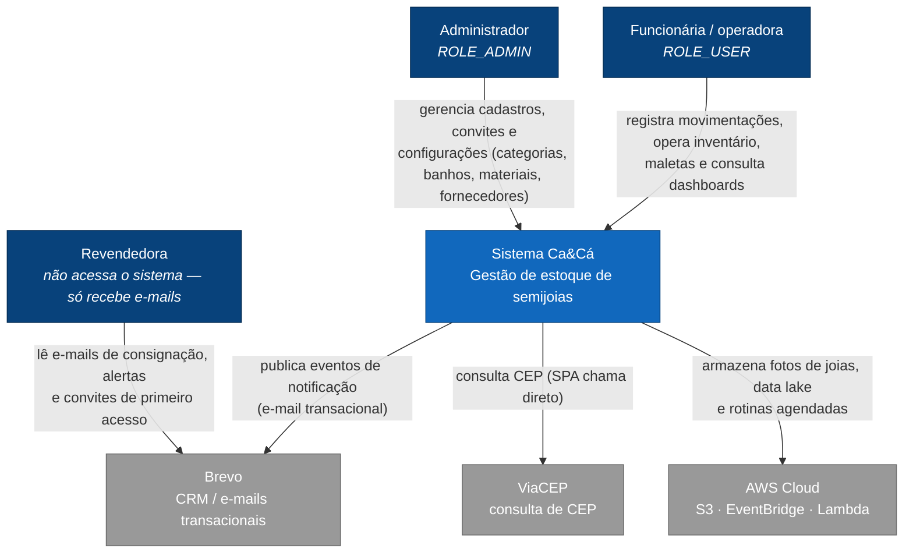
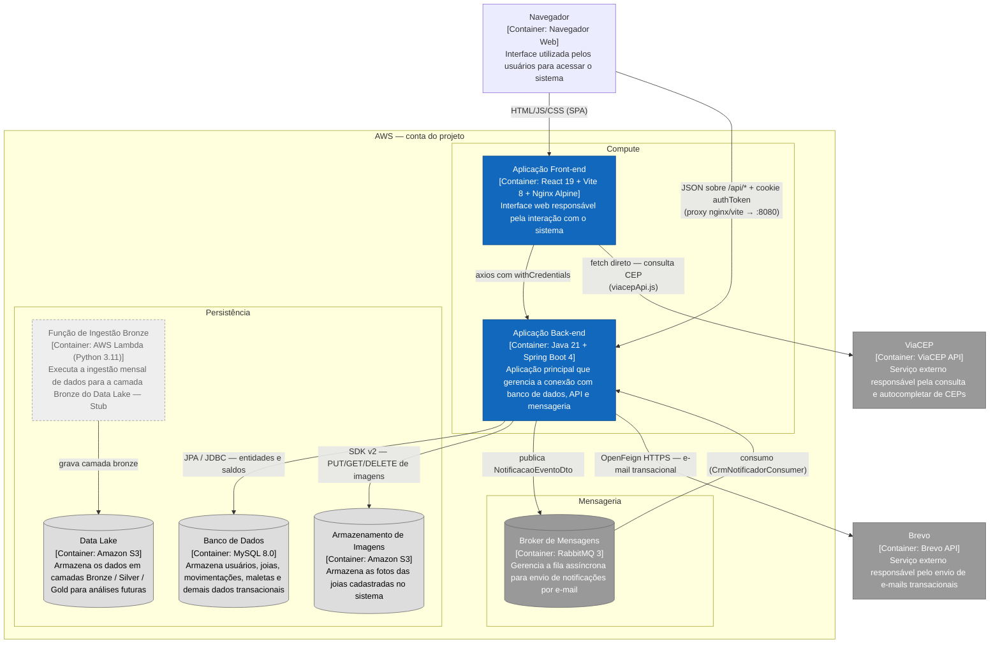
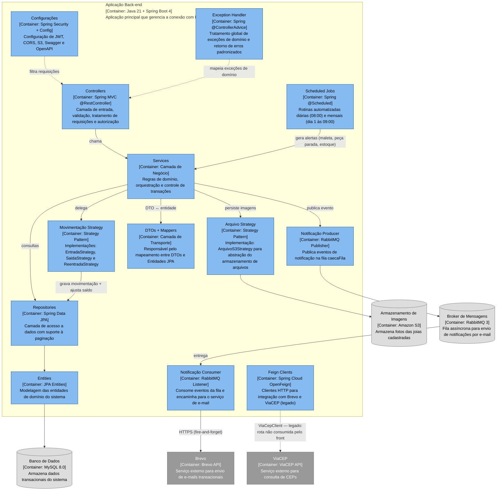
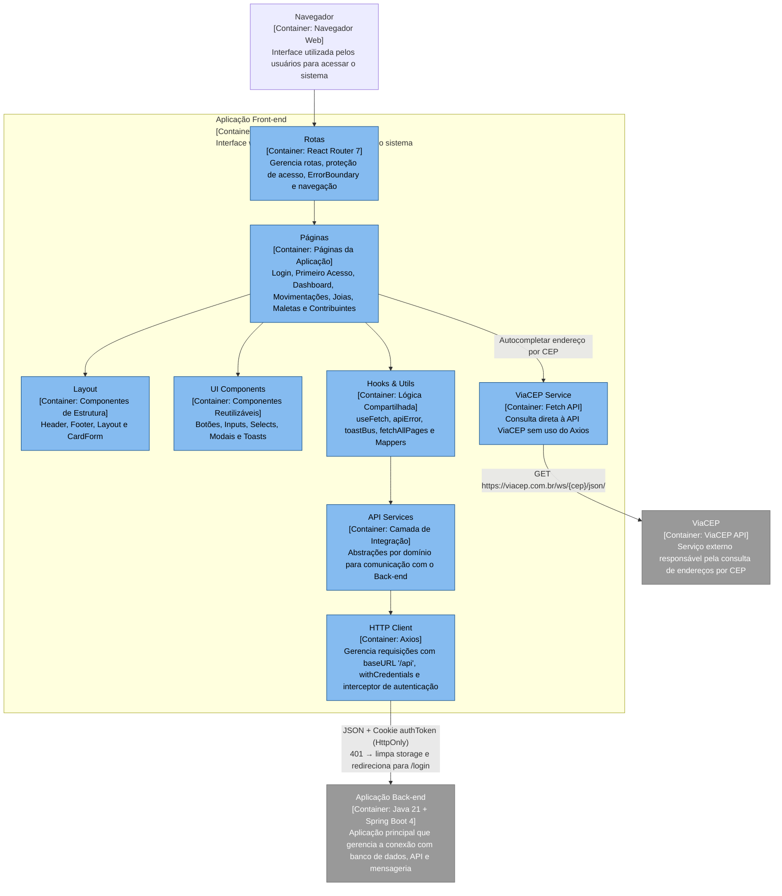
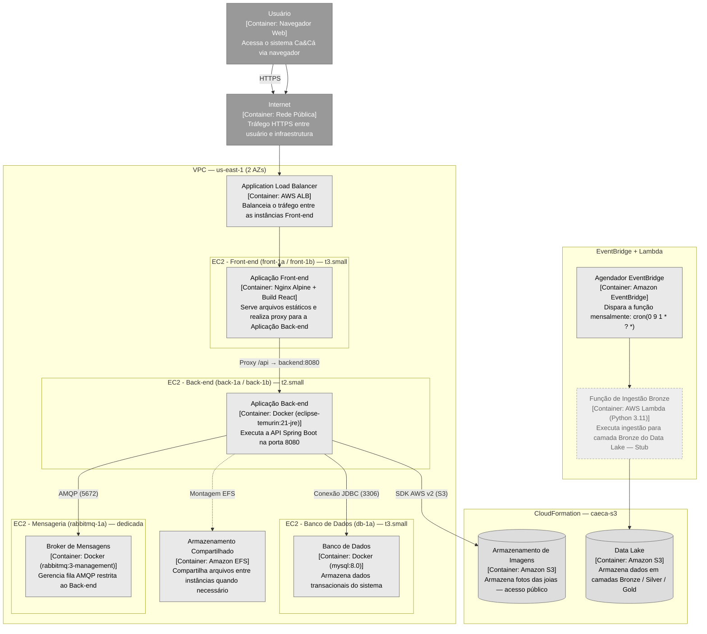
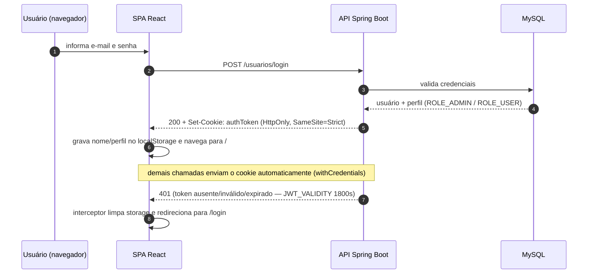
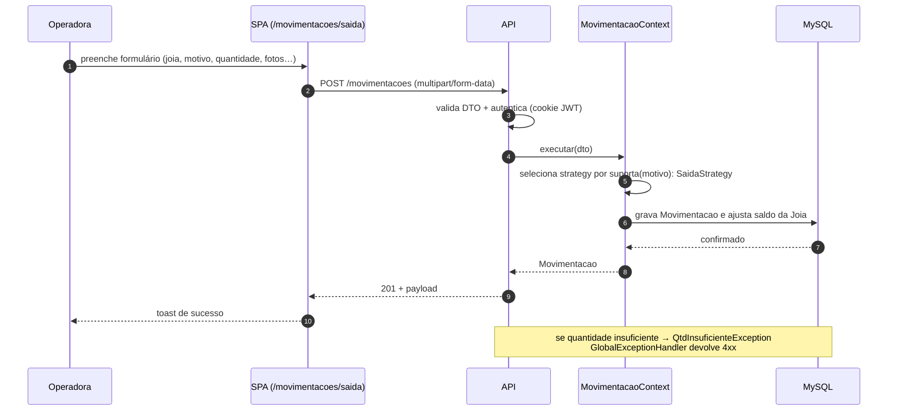
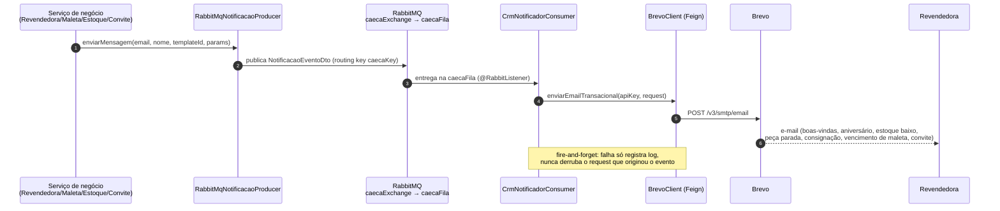
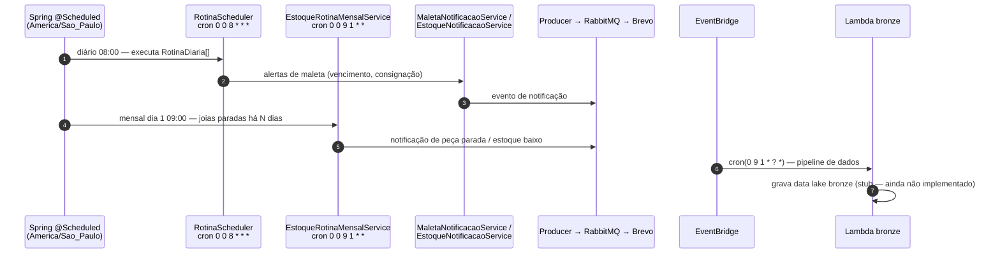

# Projeto de Extensão: Gestão de Inventário para Semijoias
Bem-vindo à organização dedicada ao desenvolvimento do sistema de gestão para vendedoras autônomas de semijoias. Este projeto faz parte das atividades de extensão acadêmica do 3º semestre.

# Contexto
Vendedoras de semijoias frequentemente lidam com um inventário composto por itens pequenos, variados e de alto valor agregado. A falta de um controle sistemático resulta em perda de mercadorias, dificuldade em calcular o lucro real, estoque parado e dificuldade de manejar os itens enviadas às clientes.

Este repositório foca em criar uma solução técnica que permita:
  Categorização por tipo de banho (ouro e prata), peça, etc.
  Controle de entradas e saídas de peças.
  Geração de alertas para reposição de estoque.
  Controle de clientes.

# Alinhamento com as ODS (Agenda 2030)
O projeto está fundamentado nos Objetivos de Desenvolvimento Sustentável da ONU:
  ODS 5 (Igualdade de Genêro): Foco na meta 5.b, visando a gestão eficiente e o uso estratégico de recursos tecnológicos para ter controle sobre o próprio dinheiro e estoque.
  ODS 8 (Trabalho Decente e Crescimento Econômico): Foco na meta 8.3, apoiando o empreendedorismo e a profissionalização de microempresas através da inovação tecnológica.

# Regras de Contribuição
Para manter a organização do código e o histórico do projeto limpo, todos os membros devem seguir as regras abaixo:
## Branches
  main: Versão estável (entrega).
  feature/nome ou nomeContribuidor: Para desenvolver tarefas específicas.
## Commits (Padrão)
Use sempre um prefixo antes da mensagem:
  feat: Nova funcionalidade.
  fix: Correção de erros.
  docs: Alteração em documentos/README.
  refactor: Melhoria no código existente.
Emplo: feat: adiciona botão de login

## 2. Topologia dos repositórios

A pasta raiz **não é um repositório git**. São **4 repositórios independentes**:

| Pasta | Repo remoto | Branch atual | Stack |
| --- | --- | --- | --- |
| `BackEnd/` | `Ca-Ca-grupo8/BackEnd.git` | `feat/integracao-brevo` | Spring Boot 4.0.5 · Java 21 · MySQL |
| `FrontEnd/caeca/` | `Ca-Ca-grupo8/FrontEnd.git` | `feat/movimentacoesMaletas` | React 19 · Vite 8 · React Router 7 |
| `Infra/` | `Ca-Ca-grupo8/Infra.git` | `main` | Terraform + CloudFormation (AWS) |
| `analiseDados/` | `Ca-Ca-grupo8/analiseDados.git` | `main` | Python / data lake (**vazio**, só `bronze/`) |

> Branches `main` defasadas em BackEnd e FrontEnd: Features relevantes só existem em
> branches de trabalho. **Não assuma que `main` está atualizado.**

### Documentos complementares

| Arquivo | Escopo |
| --- | --- |
| `BackEnd/AGENTS.md` | Detalhe do backend: convenções, testes, armadilhas de Spring Boot 4 |
| `Infra/README.md` | Detalhe da infra: buckets via CloudFormation, resto via Terraform |
| `FrontEnd/caeca/README.md` | Boilerplate do Vite (não descreve o app) |
| `C4_MODEL.md` | Modelo de arquitetura C4 (contexto, contêineres, componentes, implantação e fluxos dinâmicos) |

### Modelo C4

A arquitetura está documentada no padrão [C4](https://c4model.com/) em
[`C4_MODEL.md`](C4_MODEL.md), com diagramas em Mermaid:

| Nível | Diagrama |
| --- | --- |
| 1 — Contexto | Usuários e sistemas externos (Brevo, ViaCEP, AWS) |
| 2 — Contêineres | Frontend, API, banco e serviços de apoio |
| 3 — Componentes | Backend (`BackEnd/estoque`) e frontend (`FrontEnd/caeca`) |
| 4 — Implantação | Infraestrutura AWS (`Infra/`) |
| Dinâmicos | Autenticação, movimentação, notificação assíncrona e rotinas agendadas |

---

## Nível 1 — Diagrama de contexto

Quem usa o sistema, com quem ele interage e o que existe fora dos nossos limites.

**Atos do sistema:** autenticar usuários (JWT), cadastrar manutenção de dados
(joias, categorias, banhos, materiais, motivos), registrar movimentações de estoque,
gerenciar maletas/vendas de revendedoras, exibir dashboards e disparar notificações
assíncronas por e-mail.

---

## Nível 2 — Diagrama de contêineres

Contêineres = unidades de código executando em seu próprio processo (SPA, API,
banco, fila, buckets, functions).

### Tabela de contêineres

| Contêiner | Tecnologia | Responsabilidade |
| --- | --- | --- |
| **SPA** | React 19, Vite 8, React Router 7, axios, lucide-react (JS puro, sem TS) | UI: login, dashboard, movimentações, inventário, maletas, contribuintes (revendedoras/fornecedores/funcionários). Servida por nginx; `nginx.conf` faz `location /api/ → api.backend:8080` |
| **API** | Spring Boot 4.0.5 (MVC, Security 7, Data JPA), Maven único `estoque/` | REST (`controller` → `service` → `database`), JWT stateless, strategies de movimentação, rotinas `@Scheduled`, notificações via fila |
| **MySQL 8** | `mysql:8.0` em EC2, `ddl-auto=update` + Flyway (migrações Java) | Fonte única de dados transacionais (banco `caeca`) |
| **RabbitMQ** | `rabbitmq:3-management`, porta 5672 só para o SG do backend | Desacopla eventos de negócio do envio de e-mails (fila durável `caecaFila`) |
| **S3 fotos** | `bucket-fotos-caeca` (CloudFormation) | Imagens das joias; acesso público de leitura |
| **Data lake** | `bucket-bronze/silver/gold-caeca` (CloudFormation) | Camadas do lake — suporte ao `analiseDados/` |
| **Lambda bronze** | `funcao-python-bronze` + EventBridge `cron(0 9 1 * ? *)` | Ingestão mensal p/ bronze — **stub** (código placeholder) |
| **Brevo** | API externa (Feign) | E-mails transacionais/CRM (templates: boas-vindas, aniversário, estoque baixo, peça parada, consignação, vencimento de maleta, convite) |
| **ViaCEP** | API externa | Autocompletar endereços — chamado **direto pelo SPA** (`service/viacepApi.js` → `fetch https://viacep.com.br/ws/{cep}/json/`). O backend mantém endpoint legado `GET /enderecos/cep/{cep}` (`ViaCepClient`/Feign), não usado pelo front |

---

## Nível 3 — Componentes da API (BackEnd)

Fluxo fixo: `controller` → `service` → `database/{model,repository}`.

### Observações por componente

- **`strategy/movimentacao`** — `MovimentacaoService.cadastrar` escolhe a strategy
  via `suporta(motivo)`; para um novo tipo de movimentação cria-se uma strategy nova
  (nunca `if` no service). Os tipos atuais são `ENTRADA`, `SAIDA`, `REENTRADA`
  (`TipoMovimentacaoEnum`).
- **Maletas** — modeladas por `MovimentacaoRevendedora` (nome, `dataLimite`,
  `StatusMaleta`: `ABERTO → EM_CONSIGNACAO → EM_ACERTO → FINALIZADA | ERRO`,
  relação 1:N com `Movimentacao`); expostas sob `/vendas`.
- **Notificações** — `NotificacaoBrevoService` / `MaletaNotificacaoService` /
  `UsuarioNotificacaoService` → `NotificacaoProducer` → fila →
  `CrmNotificadorConsumer` → `BrevoClient`. O registro de envio (evita reenvio)
  fica em `NotificacaoEnvio`. O efeito é *fire-and-forget*: falha só loga.
- **Segurança** — JWT stateless (`JJWT 0.12.6`); token no **cookie HttpOnly
  `authToken`** (ou header `Authorization: Bearer`); rotas públicas em
  `URLS_PERMITIDAS` (login, convites, swagger, actuator); admin via
  `@PreAuthorize("hasAuthority('ROLE_ADMIN')")`; CORS fixo em
  `localhost:5173` / `localhost:3000`.
- **Dashboards** — `DashboardController` (`/dashboard`: top-cinco, giro-estoque,
  motivos de saída/reentrada, top-5 mais frios, índice de peças frias) +
  `DashboardComparacaoController` (`/api/dashboard/kpis-e-grafico`).

### Mapeamento de endpoints (resumo)

| Base | Operações |
| --- | --- |
| `/usuarios` | `POST` criar, `POST /login`, `POST /logout`, `GET`, `GET /me` |
| `/usuarios/convites` | criar, reenviar, validar token, definir senha (primeiro acesso) |
| `/joias` | `GET` paginado, `GET/{id}`, `POST`, `PATCH/{id}` |
| `/movimentacoes` | `GET`, `GET/{id}`, `POST` (multipart/form-data) |
| `/vendas` (maletas) | `GET`, `GET/{id}`, `PATCH/{id}`, `POST` |
| `/revendedoras`, `/fornecedores` | CRUD + status |
| `/enderecos` | CRUD + `GET /cep/{cep}` (ViaCEP — **legado**, o front consulta direto) |
| `/arquivos` | upload/delete de foto por joia (S3) |
| `/categorias`, `/materiais`, `/banhos`, `/motivos-movimentacao` | leitura + criação |
| `/tipos-movimentacao`, `/status-maletas` | `GET` |
| `/dashboard`, `/api/dashboard` | métricas e gráficos |

---

## Nível 3 — Componentes do frontend (FrontEnd/caeca)

- **Dev:** proxy do Vite (`/api → http://localhost:8080`, removendo o prefixo).
  **Prod:** mesmo repasse no `nginx.conf` do container.
- Rotas protegidas por `ProtectedRoute` (sessão derivada do cookie + perfil no
  `localStorage`); `/login` e `/primeiro-acesso` são públicas.

---

## Nível 4 — Diagrama de implantação

Infra gerida por **Terraform** (rede, compute, ALB, EFS) + **CloudFormation**
(buckets S3 — SCP da conta impede o Terraform de gerenciá-los).

> Bootstrap por `user_data` (`cloud_init_{front,back,db,rabbitmq}.yaml`) — roda
> apenas na criação da instância; mudanças exigem `terraform apply -replace`.

---

## Fluxos dinâmicos

### 1. Autenticação (login → cookie HttpOnly)

### 2. Movimentação de estoque (ex.: saída)

### 3. Notificação assíncrona (fila → Brevo)

### 4. Rotinas agendadas

---

## Legenda da notação

| Símbolo | Significado |
| --- | --- |
| Retângulo azul escuro | Pessoa / ator |
| Retângulo azul | Sistema ou contêiner de software em execução |
| Retângulo cinza | Sistema externo (fora do nosso controle) |
| Elipse cinza | Dados / armazenamento (banco, bucket, fila) |
| Retângulo tracejado | Componente previsto / stub (não implementado) |
| Seta contínua | Comunicação síncrona (requisição) |
| Seta pontilhada | Influência / dependência opcional |
| Diagrama de sequência | Fluxo dinâmico (interação temporal) |

Modelo alinhado ao C4 de Simon Brown: **Contexto (1)** → **Contêineres (2)** →
**Componentes (3)** → **Código/Implantação (4)**, mais vistas dinâmicas
(sequência) para os fluxos críticos.
